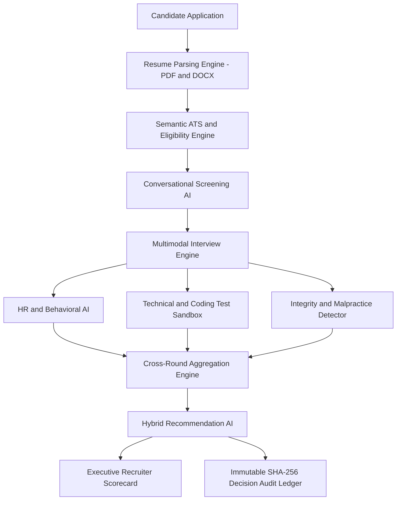

# 🤖 Zecpath AI – Intelligent Recruitment & Interview System 🚀
*Autonomous End-to-End Recruitment Intelligence & Hiring Automation Platform*

[](https://www.python.org/)
[](https://fastapi.tiangolo.com/)
[](https://react.dev/)
[-brightgreen.svg)](tests/)

Zecpath AI is an enterprise-grade AI-powered recruitment and job portal platform designed to automate and elevate hiring workflows for both Job Seekers and Recruiters. The system combines ATS (Applicant Tracking System), multi-format resume parsing, semantic candidate scoring, conversational screening dialogues, adaptive HR and technical interviews, real-time malpractice and proctoring telemetry, unified cross-round score aggregation, and tamper-evident cryptographic decision auditing.

---

## 📑 Table of Contents

- [System Overview & Objectives](#-system-overview--objectives)
- [System Architecture](#-system-architecture)
- [AI Recruitment Pipeline](#-ai-recruitment-pipeline)
- [Technology Stack](#-technology-stack)
- [Repository Structure](#-repository-structure)
- [Setup & Installation](#-setup--installation)
- [Running Demos & Simulations](#-running-demos--simulations)
- [Automated Testing](#-automated-testing)
- [Days 61–70 Milestone Deliverables](#-days-6170-milestone-deliverables)
- [70-Day Development Journey](#-70-day-development-journey)
- [Developer & Project Links](#-developer--project-links)

---

## 🌟 System Overview & Objectives

Traditional recruitment suffers from high time-to-hire (averaging 28+ days), resume review fatigue, subjective and inconsistent interview evaluations, and rising malpractice risks in remote technical assessments.

**Zecpath AI solves this with:**
1. **Multi-Format Resume Parsing:** Ingests and extracts structured entities (skills, degrees, career continuity) from PDF and DOCX files.
2. **Semantic ATS & Eligibility Engine:** Uses TF-IDF lexical matching and cosine vector embeddings to benchmark candidates against job descriptions.
3. **Conversational Screening AI:** Conducts dynamic multi-turn dialogues evaluating communication clarity and role enthusiasm.
4. **Multimodal Technical & HR Evaluation:** Live code AST syntax verification, algorithmic efficiency evaluation ($O(1)$ vs $O(N)$), and STAR-method behavioral scoring.
5. **Real-Time Proctoring & Malpractice Defense:** Monitors tab switches, window-blur events, and bulk clipboard paste anomalies.
6. **Unified Decision AI & Audit Ledger:** Aggregates multi-round scores with calibrated weights and seals every verdict with an immutable SHA-256 cryptographic signature.

---


## 🏛️ System Architecture




## 🔄 AI Recruitment Pipeline

```text
Resume Upload (PDF / DOCX)
  ↓
Entity Extraction & Parsing (Skills, Education, Seniority)
  ↓
Semantic ATS Scoring (TF-IDF + Cosine Similarity)
  ↓
Eligibility Verification (Hard Requirements Check)
  ↓
Conversational AI Screening (Intent & Communication Fluency)
  ↓
Technical Sandbox (Code Correctness & Algorithmic Efficiency)
  ↓
HR Behavioral Evaluation (STAR Framework & Leadership)
  ↓
Real-Time Anti-Malpractice Telemetry (Tab Switches & Paste Detection)
  ↓
Cross-Round Score Aggregation & Fit Index Calculation
  ↓
Autonomous Recommendation (Selected / Hold / Rejected)
  ↓
Cryptographic SHA-256 Decision Audit & Recruiter Scorecard
```

---

## 🛠️ Technology Stack

- **Backend:** Python 3.11, FastAPI, Uvicorn, Pydantic, SQLAlchemy, SQLite
- **AI / NLP & Processing:** spaCy, PyPDF / pdfminer, python-docx, Scikit-learn (TF-IDF & Cosine Similarity), AST Syntax Analyzers
- **Observability & Security:** Custom In-Memory Telemetry Tracker (`AIMonitoringSystem`), SHA-256 Tamper-Evident Ledger, Structured Error Recovery
- **Frontend:** React 18, Vite, Vanilla CSS Modern Glassmorphism UI
- **Testing & Verification:** Pytest (42 automated test suites)

---

## 📁 Repository Structure

```text
Zecpath-AI-System/
├── api/                   # FastAPI REST API layer
│   ├── routes/            # Routes (resume, scoring, assessment, integration, monitoring)
│   ├── models/            # SQLAlchemy DB models & Pydantic schemas
│   ├── errors.py          # Standardized error recovery & exception handlers
│   └── main.py            # ASGI entrypoint & middleware configuration
├── parsers/               # Multi-format document parsers (PDF, DOCX)
├── semantic_matching/     # TF-IDF, Vector embeddings, cosine similarity
├── ats_engine/            # ATS scoring, keyword matching & eligibility verification
├── screening_ai/          # Conversational screening dialogue manager & NLP intent parsing
├── interview_ai/          # Multimodal interview engines (HR, Technical, Integrity detection)
├── unified_scoring/       # Cross-round aggregation & final hiring recommendations
├── performance/           # Observability, caching, benchmarking & monitoring
├── simulation/            # End-to-end recruitment pipeline simulators
├── scripts/               # Standalone live demo scripts (Day 70 final demo)
├── data/                  # Sample resumes, question banks, demo dataset
├── tests/                 # Automated pytest test suites (Days 53–70)
├── frontend/              # React/Vite web application UI
└── docs/                  # Architectural documentation, handbooks & day-wise deliverables
```

---

## ⚙️ Setup & Installation

### 1. Clone the Repository
```bash
git clone https://github.com/shinaspn198/AI_POWERED_JOB_PORTAL_AUTOMATED_HIRING_ASSISTANT.git
cd Zecpath-AI-System
```

### 2. Create & Activate Virtual Environment
**Windows:**
```bash
python -m venv venv
.\venv\Scripts\activate
```

**Linux / macOS:**
```bash
python3 -m venv venv
source venv/bin/activate
```

### 3. Install Dependencies
```bash
pip install -r requirements.txt
```

### 4. Initialize Database
```bash
python api/init_db.py
```

### 5. Launch FastAPI Backend Server
```bash
uvicorn api.main:app --host 0.0.0.0 --port 8000 --reload
```
- Interactive Swagger UI: [http://localhost:8000/docs](http://localhost:8000/docs)
- Live Telemetry Metrics: [http://localhost:8000/api/monitoring/metrics](http://localhost:8000/api/monitoring/metrics)
- Recruiter Dashboard Stats: [http://localhost:8000/api/monitoring/dashboard](http://localhost:8000/api/monitoring/dashboard)

### 6. Launch Frontend Interface
```bash
cd frontend
npm install
npm run dev
# Accessible at: http://localhost:5173
```

---

## 🎬 Running Demos & Simulations

Execute the realistic end-to-end recruitment simulation across diverse candidate tiers:

```bash
# Run realistic demo pipeline simulation (Days 61–70 verified)
python simulation/demo_pipeline_simulation.py

# Run standalone live demo script (Day 70 Handover)
python scripts/final_live_demo.py
```

---

## 🧪 Automated Testing

Run the complete test suite verifying all modules, edge cases, and cross-round scoring engines:

```bash
# Run all automated test suites (42 passed)
pytest tests/

# Run specific Day 61-70 test modules
pytest tests/test_day61_observability.py
pytest tests/test_day63_demo_dataset.py
pytest tests/test_day65_enhancements.py
pytest tests/test_day68_system_validation.py
```

---

## 📚 Days 61–70 Milestone Deliverables

- [Day 61: AI Monitoring & Observability Plan](file:///docs/DAY61_AI_OBSERVABILITY_PLAN.md)
- [Day 62: Zecpath AI Technical Handbook](file:///docs/DAY62_TECHNICAL_HANDBOOK.md)
- [Day 62: Developer Onboarding Guide](file:///docs/DAY62_DEVELOPER_ONBOARDING.md)
- [Day 64: Internal Review & System Walkthrough](file:///docs/DAY64_INTERNAL_REVIEW_REPORT.md)
- [Day 65: Feature Enhancement & Polished Outputs Report](file:///docs/DAY65_FEATURE_ENHANCEMENT_REPORT.md)
- [Day 66: Stakeholder Presentation Deck](file:///docs/DAY66_PRESENTATION_DECK.md)
- [Day 66: Demonstration Script & Speaker Notes](file:///docs/DAY66_DEMO_SCRIPT.md)
- [Day 67: Mock Demo Feedback Report](file:///docs/DAY67_MOCK_DEMO_FEEDBACK.md)
- [Day 67: Stakeholder Q&A Defense Guide](file:///docs/DAY67_STAKEHOLDER_QA_GUIDE.md)
- [Day 67: Final Demo Readiness Checklist](file:///docs/DAY67_DEMO_READINESS_CHECKLIST.md)
- [Day 68: Final Optimization & Bug Fix Report](file:///docs/DAY68_BUG_FIX_REPORT.md)
- [Day 69: AI Engineering Internship Portfolio](file:///docs/DAY69_INTERNSHIP_PORTFOLIO.md)
- [Day 70: Final Handover & Evaluation Report](file:///docs/DAY70_FINAL_HANDOVER_AND_EVALUATION.md)

---

## 👨‍💻 Developer & Project Links

**Developer:**
- **Shinas PN** (BCA – AI Specialization)
- **Role:** AI/ML & Full-Stack Systems Engineer Intern

**Project Links:**
- **Repository:** [https://github.com/shinaspn198/AI_POWERED_JOB_PORTAL_AUTOMATED_HIRING_ASSISTANT](https://github.com/shinaspn198/AI_POWERED_JOB_PORTAL_AUTOMATED_HIRING_ASSISTANT)
- **Live Demo:** [https://ai-powered-job-portal-automated-hir.vercel.app/)

---

## 📜 License
This project is developed for educational, internship, and portfolio purposes under the Zecpath AI Recruitment platform initiative.
