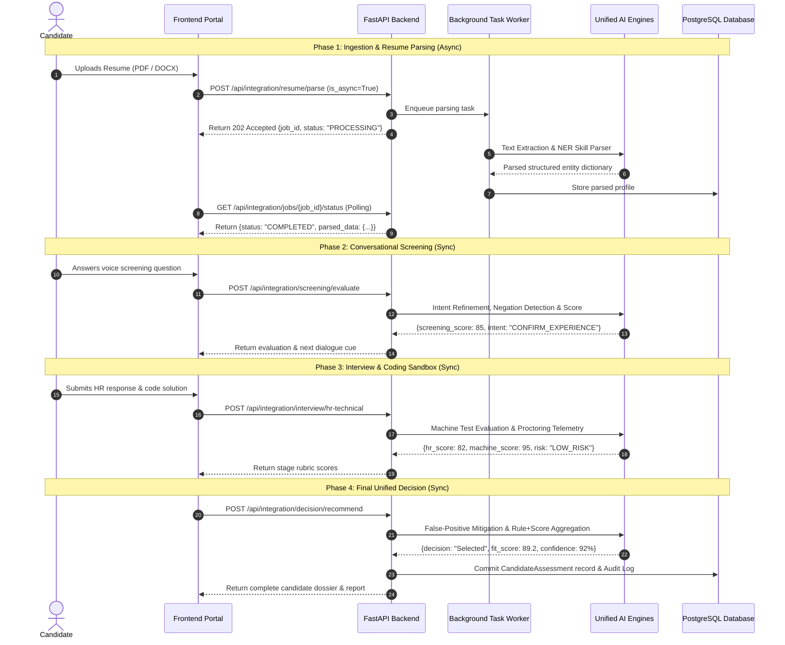

# Day 59 – API Mapping Diagram & Dataflow Specifications

**Project:** Zecpath Autonomous AI Hiring System  
**Stage:** Day 59  
**Focus:** Sequence Flows, Data Models & Endpoint Contracts

---

## 1. End-to-End API Interaction Sequence

---

## 2. API Endpoint Catalog

| Endpoint | Method | Input Schema | Output Schema | Latency Target |
| :--- | :---: | :--- | :--- | :---: |
| `/api/integration/resume/parse` | `POST` | `ResumeParseRequest` | `ResumeParseResponse` | < 1.5s (Async) |
| `/api/integration/jobs/{id}/status` | `GET` | `job_id: str` | `ResumeParseResponse` | < 10ms |
| `/api/integration/ats/score` | `POST` | `AtsScoringRequest` | `AtsScoringResponse` | < 30ms |
| `/api/integration/screening/evaluate` | `POST` | `ScreeningEvaluateRequest` | `ScreeningEvaluateResponse` | < 50ms |
| `/api/integration/interview/hr-technical` | `POST` | `InterviewEvaluateRequest` | `InterviewEvaluateResponse` | < 60ms |
| `/api/integration/decision/recommend` | `POST` | `DecisionRecommendRequest` | `DecisionRecommendResponse` | < 40ms |
