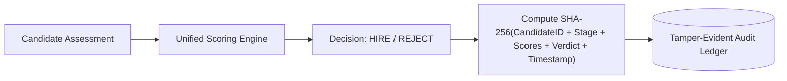

# Day 61 — AI Monitoring & Observability Design

## 1. Executive Summary
This document establishes the production-grade Observability, Monitoring, Alerting, and Decision Auditing architecture for the Zecpath AI System. The system tracks real-time inference latency, throughput, error anomalies, model confidence degradation, and provides a cryptographically tamper-evident decision audit trail for hiring integrity and legal compliance.

---

## 2. Structured Logging System Design

The observability system is partitioned into three standardized logging streams:

### 2.1 API Request & Latency Telemetry (`api_logs`)
Captured automatically via FastAPI ASGI middleware for every incoming request:
- **Timestamp (UTC ISO 8601):** e.g., `2026-10-15T16:00:00Z`
- **HTTP Method & Route:** `GET`, `POST`, `PUT`, `DELETE` with normalized path (e.g., `/api/scoring/evaluate`)
- **Status Code:** HTTP 200, 400, 422, 500
- **Latency (ms):** High-precision millisecond timing (`time.perf_counter()`)
- **Error Trace:** Captured exception message when status >= 400

### 2.2 Model Inference Logs (`model_logs`)
Tracks AI model invocations across ATS, Semantic Matching, Screening AI, and Interview rounds:
- **Model Identifier:** `ats_semantic_matcher`, `hr_behavioral_scorer`, `coding_evaluator`, `integrity_detector`
- **Input Digest:** Sanitized snippet/length of input prompt or candidate profile
- **Inference Score / Prediction:** Computed float score (0–100) or classification label
- **Inference Time (ms):** Dedicated sub-millisecond execution duration
- **Metadata:** Hyperparameters, model version (`v1.2.0`), candidate ID context

### 2.3 System & Component Error Logs (`error_logs`)
- **Component:** `Parser`, `Database`, `ScoringEngine`, `InferenceWorker`
- **Error Type:** `ValidationException`, `ModelTimeout`, `IntegrityViolation`
- **Stack Trace:** Structured dictionary and traceback for rapid root-cause analysis

---

## 3. Key Operational & AI Metrics

| Metric Name | Calculation Method | Target SLA | Critical Threshold |
| :--- | :--- | :--- | :--- |
| **Response Time (p95)** | 95th percentile latency across endpoints | < 800 ms | > 2000 ms |
| **API Failure Rate** | `(Failed Requests / Total Requests) * 100` | < 1.0% | > 5.0% |
| **Model Output Confidence** | Rolling average of candidate evaluation scores | 70% – 85% | < 65.0% (Anomaly) |
| **Parsing Success Rate** | `(Successfully Parsed Resumes / Total Uploads) * 100` | > 98.0% | < 90.0% |
| **Integrity Violation Rate** | Flagged malpractice events / Total interview sessions | < 5.0% | > 15.0% |

---

## 4. Alerting Engine & Trigger Rules

The alerting subsystem continuously evaluates operational metrics against predefined policy thresholds:

```json
{
  "alert_rules": {
    "HIGH_LATENCY": {
      "threshold_ms": 2000.0,
      "severity": "WARNING",
      "action": "Notify SRE Slack channel / Auto-scale inference workers"
    },
    "HIGH_FAILURE_RATE": {
      "threshold_ms_or_pct": 5.0,
      "severity": "CRITICAL",
      "action": "Trigger PagerDuty / Enable Circuit Breaker"
    },
    "LOW_MODEL_CONFIDENCE": {
      "min_score_pct": 65.0,
      "severity": "WARNING",
      "action": "Flag for human reviewer audit (Model Drift Detection)"
    }
  }
}
```

---

## 5. Recruiter & Administrator Monitoring Dashboard

The monitoring dashboard exposes high-level hiring funnel performance and live telemetry:

### 5.1 Candidate Processing Funnel
- **Total Candidates Processed:** Cumulative resumes received.
- **ATS Screened:** Resumes matching mandatory requirements.
- **Interviews Conducted:** HR, Technical, and Aptitude rounds completed.
- **Offers Extended:** Final candidates recommended by the Unified Decision Engine.
- **Interview Success Rate:** `(Offers / Total Processed) * 100`.

### 5.2 Live System Health Indicators
- Real-time p95 Latency gauge (Green / Yellow / Red).
- Error Rate thermometer.
- Active system alerts ticker.

---

## 6. Immutable Decision Audit Log Architecture

To ensure explainability, transparency, and compliance with anti-discrimination employment standards (EEOC / EU AI Act), all hiring decisions are recorded with an immutable cryptographic signature.



### Audit Record Schema:
```json
{
  "timestamp": "2026-10-15T16:15:30.124Z",
  "candidate_id": "CAND-0D717295",
  "job_id": "JOB-ENG-001",
  "stage": "FINAL_DECISION",
  "scores": {
    "ats_score": 88.5,
    "technical_score": 84.0,
    "hr_score": 82.0,
    "integrity_score": 96.0
  },
  "verdict": "HIRE",
  "model_version": "1.0.0",
  "operator": "AI_DECISION_ENGINE",
  "integrity_hash": "e3b0c44298fc1c149afbf4c8996fb92427ae41e4649b934ca495991b7852b855"
}
```

Any modification to past scores or decisions invalidates the cryptographic SHA-256 hash, immediately alerting compliance officers.
