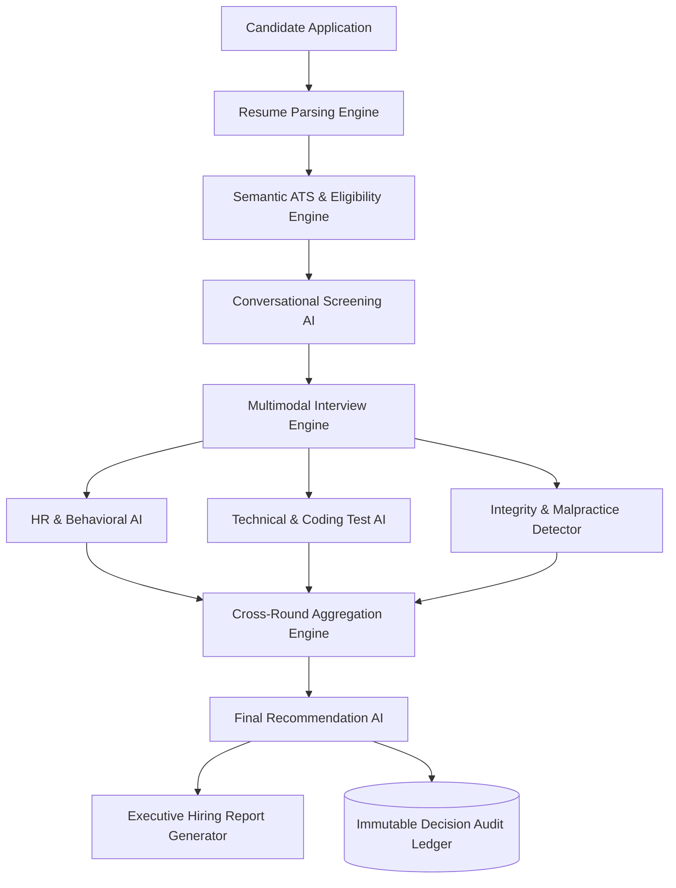

# Day 62 — Zecpath AI Technical Handbook

## 1. System Overview & Purpose
The **Zecpath AI System** is an end-to-end, enterprise-grade Automated Hiring & Recruitment Intelligence platform. It orchestrates the entire talent acquisition pipeline—from multi-format resume parsing and semantic ATS scoring, through automated multi-turn candidate screening, AI-conducted HR and technical interviews, real-time integrity and malpractice detection, up to cross-round score aggregation and final hiring recommendation generation.

---

## 2. Core Architecture & Component Hierarchy



---

## 3. Module Breakdown & Algorithms

### 3.1 Resume Parsing & Extraction (`parsers/`, `education_parser/`, `experience_parser/`)
- **Technologies:** `pdfminer`, `python-docx`, regex heuristics, Spacy NLP.
- **Functionality:** Extracts structured entities: contact information, technical skills, education degrees, institutional tier, employment history, and career continuity.
- **Fault-Tolerance:** Handles corrupted PDFs, malformed tables, missing sections, and multi-column formats.

### 3.2 Semantic Matching & ATS Scoring (`semantic_matching/`, `ats_engine/`, `ats_score.py`)
- **Scoring Weights:**
  - Skill Overlap (TF-IDF & Embeddings): 40%
  - Experience Relevance & Seniority: 30%
  - Educational Alignment: 15%
  - Semantic Cosine Similarity: 15%
- **Eligibility Engine:** Enforces mandatory pass/fail criteria (minimum experience, required certifications, work authorization).

### 3.3 Conversational Screening AI (`screening_ai/`)
- Dynamic dialogue manager assessing candidate readiness, salary expectations, role enthusiasm, and communication fluency.
- Intent classification with adaptive follow-up questioning.

### 3.4 Interview AI Suite (`interview_ai/`)
- **HR Behavioral Scorer:** Evaluates leadership, teamwork, stress response, and culture-add using structured rubrics.
- **Technical & Machine Test AI:** Assesses algorithmic efficiency, code correctness, language mastery, and system design aptitude.
- **Malpractice & Integrity Detector:** Monitors window-blur events, clipboard pastes, gaze shifts, audio-video anomalies, and AI-generated answer signatures.

### 3.5 Unified Scoring & Decision Engine (`unified_scoring/`, `candidate_ranking.py`)
- Aggregates multi-round vector scores with calibrated weights:
  $$\text{Final Fit} = 0.25 \times \text{ATS} + 0.20 \times \text{Screening} + 0.25 \times \text{Technical} + 0.20 \times \text{HR} + 0.10 \times \text{Integrity}$$
- Automatic disqualification if Malpractice Severity > High or Integrity Score < 60%.

### 3.6 Observability, Monitoring & Audit (`performance/ai_monitoring.py`)
- Real-time p95 latency tracking, API telemetry, model drift detection, and SHA-256 tamper-evident decision auditing.

---

## 4. REST API Specification Summary

| Method | Endpoint | Description |
| :--- | :--- | :--- |
| `POST` | `/api/auth/login` | Recruiter authentication & JWT generation |
| `POST` | `/api/resume/upload` | Multipart resume upload & structured extraction |
| `POST` | `/api/scoring/evaluate` | ATS criteria evaluation & eligibility verification |
| `POST` | `/api/assessment/evaluate-dialogue` | Screening & conversational response evaluation |
| `POST` | `/api/assessment/interview-round` | Technical / HR round submission & scoring |
| `POST` | `/api/assessment/integrity-check` | Real-time proctoring & malpractice event logging |
| `POST` | `/api/assessment/recommend-decision` | Unified multi-round aggregation & hire recommendation |
| `GET` | `/api/monitoring/metrics` | System telemetry, failure rates, and active alerts |
| `GET` | `/api/monitoring/dashboard` | Candidate funnel statistics and pass rates |
| `GET` | `/api/monitoring/audit-trail` | Cryptographically signed decision history |

---

## 5. Data Models & Schemas

### Candidate Profile Model (`api/models/candidate.py`)
```python
class Candidate(BaseModel):
    id: str
    name: str
    email: str
    phone: Optional[str]
    skills: List[str]
    experience_years: float
    education: List[Dict[str, Any]]
    created_at: datetime
```

### Assessment Scores Model (`api/models/candidate_assessment.py`)
```python
class AssessmentScores(BaseModel):
    ats_score: float
    screening_score: float
    hr_behavioral_score: float
    technical_score: float
    integrity_score: float
    weighted_total: float
    recommendation: str  # "HIRE", "SHORTLIST", "REJECT"
```

---

## 6. Setup, Configuration & Deployment Guide

### Prerequisites
- Python 3.10+ / 3.11+
- Node.js 18+ and npm
- SQLite / PostgreSQL

### Backend Installation & Startup
```bash
# Clone & Navigate
cd Zecpath-AI-System

# Activate Python Virtual Environment
.\venv\Scripts\activate

# Install dependencies
pip install -r requirements.txt

# Initialize Database
python api/init_db.py

# Launch FastAPI ASGI Server
uvicorn api.main:app --host 0.0.0.0 --port 8000 --reload
```

### Frontend Startup
```bash
cd frontend
npm install
npm run dev
# Accessible at http://localhost:5173
```

### Containerized Deployment (Docker)
```bash
docker build -t zecpath-ai-backend .
docker run -d -p 8000:8000 --env-file .env zecpath-ai-backend
```
