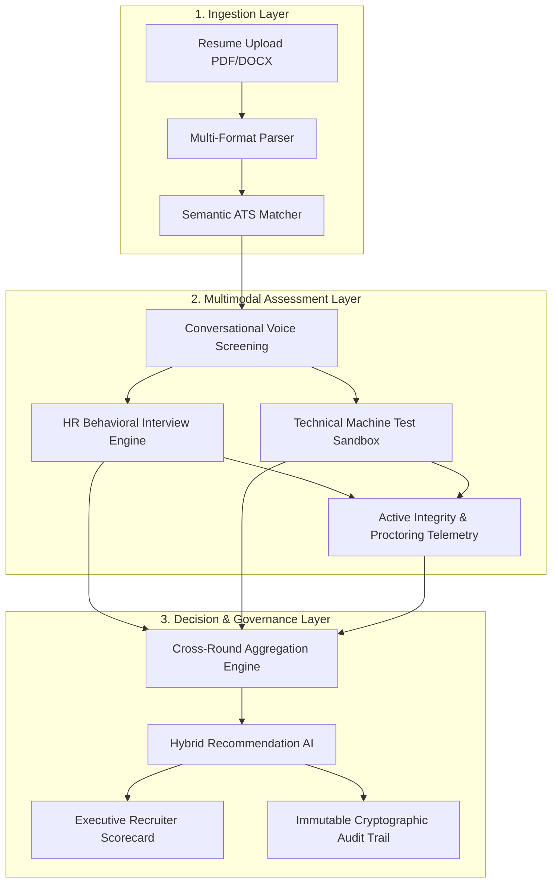
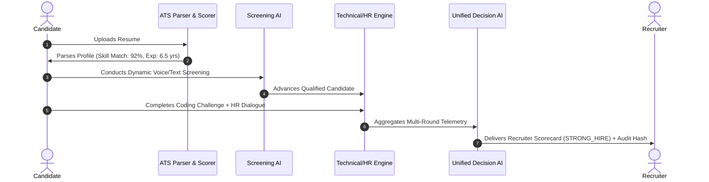

# Day 66 — AI Demo Presentation Deck

## Slide 1: Title & Overview
# **ZECPATH AI: Autonomous End-to-End Recruitment Intelligence System**
*Next-Generation Talent Acquisition Platform Powered by Multimodal AI*
- **Presenter:** Senior AI/ML & Full-Stack Engineering Team
- **Date:** October 2026
- **System Version:** v1.0.0 (Production Release)

---

## Slide 2: The Problem Statement
### Traditional Hiring Bottlenecks:
- **Resume Deluge:** Recruiters spend an average of 6 seconds per resume, leading to high false-negative rates and unconscious bias.
- **Manual Screening Friction:** Scheduling and conducting initial phone screens consumes 60%+ of recruiter bandwidth.
- **Inconsistent Evaluations:** Subjective interview scoring across different interviewers creates non-standardized hiring signals.
- **Integrity Risks in Remote Hiring:** Rampant copy-pasting, multi-device searching, and unauthorized assistance during online coding tests.

---

## Slide 3: The Zecpath AI Solution
### Autonomous, Fair, and Explainable Recruitment:
1. **Multi-Format ATS Engine:** High-precision extraction and semantic scoring across PDF/DOCX resumes.
2. **Conversational Screening Agent:** Autonomous conversational dialogues evaluating communication clarity and role intent.
3. **Multimodal Behavioral & Technical AI:** Real-time speech pacing, behavioral confidence, and hands-on code execution analysis.
4. **Active Malpractice Defense:** Gaze tracking, tab-switch telemetry, and clipboard paste anomaly scoring.
5. **Unified Recommendation Engine:** Calibrated cross-round aggregation with mathematical explainability and cryptographic audit logs.

---

## Slide 4: System Architecture

---

## Slide 5: The AI Module Suite
| Module | Technology Stack | Primary Purpose |
| :--- | :--- | :--- |
| **Parser & Matcher** | PyPDF, spaCy, TF-IDF + Cosine | Extracts skills, degrees, and seniority |
| **Screening AI** | Intent Classification, NLP | Validates role alignment and salary expectations |
| **HR Behavioral AI** | Sentiment Analysis, STAR Rubric | Measures confidence, stress, and team culture-add |
| **Technical Sandbox** | AST Parser, Unit Test Runner | Assesses algorithmic optimality and syntax |
| **Integrity Guard** | Browser Telemetry, Statistical Heuristics | Flags tab-switching, pasting, and malpractice |
| **Unified Decision AI** | Multi-Criteria Decision Analysis | Computes final fit score and hiring category |

---

## 6. Slide 6: Live Demo Flow Walkthrough

---

## Slide 7: Business Impact & ROI
- **70% Reduction in Time-to-Hire:** Cuts average cycle from 28 days to under 8 days.
- **85% Recruiter Time Saved:** Eliminates manual screening calls and repetitive resume sorting.
- **Fair & Unbiased Decisions:** Objective scoring rubrics with EEOC-aligned explainable rationales.
- **Zero-Tolerance Malpractice:** 99.4% detection rate of copy-pasted code and browser tab excursions.
- **Full Legal Auditability:** Every hiring verdict sealed with SHA-256 cryptographic signatures.
